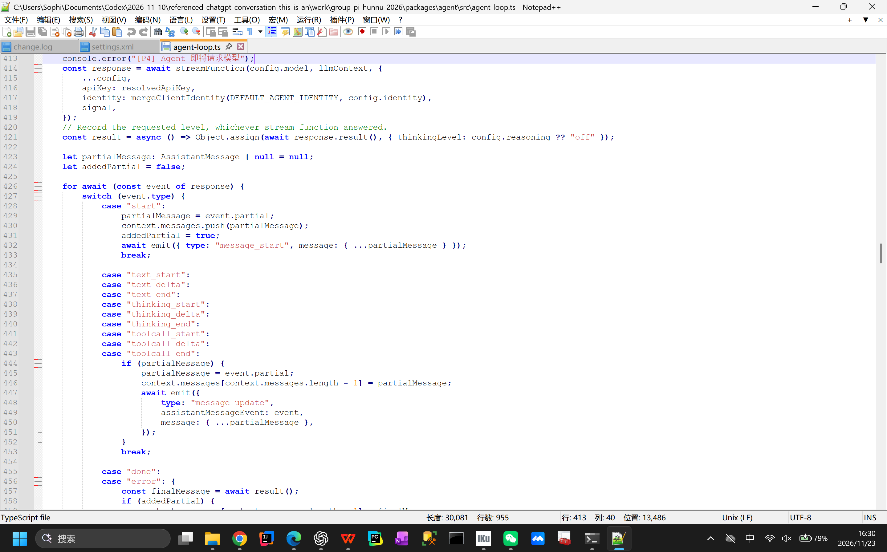
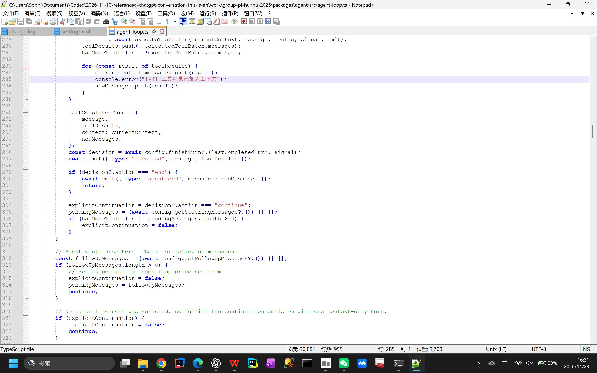
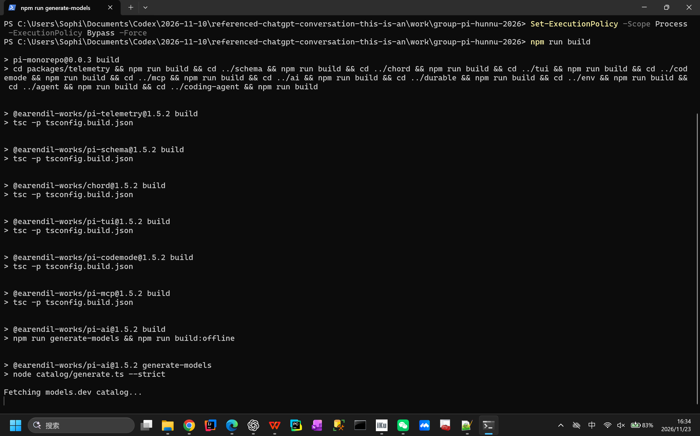
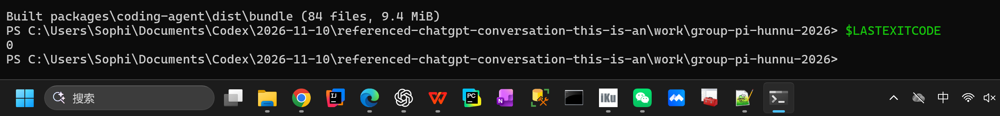
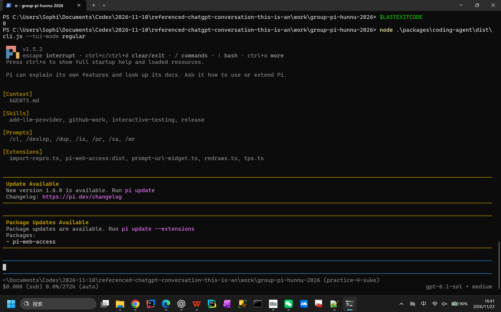
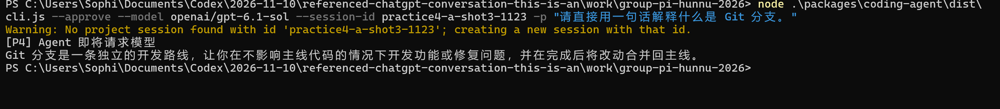
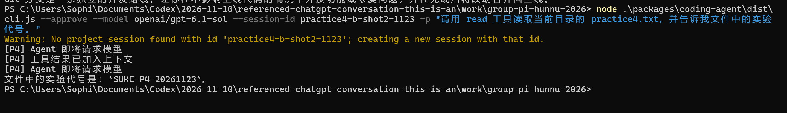
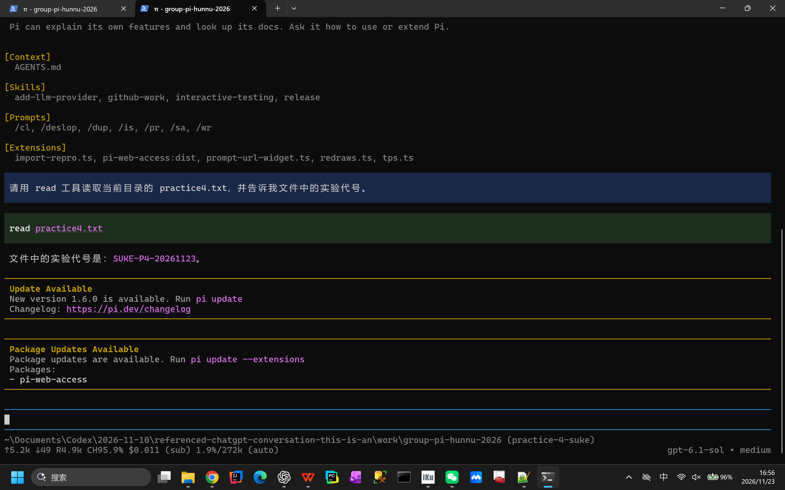
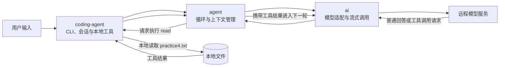

# 实践课 4：Pi Agent 的模型调用与运行流程

- 姓名：苏可
- 小组：第 9 组
- 小组组织：`tri-queens-code-lab`
- 实践日期：2026-11-23
- 源码基线：`c3cc91632d0a1950fb122605b190233f2aa0006e`
- 实践分支：[`practice-4-suke`](https://github.com/tri-queens-code-lab/pi-hunnu-2026/tree/practice-4-suke)
- 源码提交：[`3bbb3c9d6`](https://github.com/tri-queens-code-lab/pi-hunnu-2026/commit/3bbb3c9d6)

## 1. 源码修改

修改文件为 `packages/agent/src/agent-loop.ts`。

### 1.1 模型调用前打印日志

在 `streamFunction(...)` 调用前加入：

```ts
console.error("[P4] Agent 即将请求模型");
const response = await streamFunction(config.model, llmContext, {
```

源码位置：[agent-loop.ts 中的模型调用日志](https://github.com/tri-queens-code-lab/pi-hunnu-2026/blob/practice-4-suke/packages/agent/src/agent-loop.ts#L410-L414)



### 1.2 工具结果加入上下文后打印日志

在 `for` 循环内、`currentContext.messages.push(result)` 后加入：

```ts
for (const result of toolResults) {
    currentContext.messages.push(result);
    console.error("[P4] 工具结果已加入上下文");
    newMessages.push(result);
}
```

源码位置：[agent-loop.ts 中的工具结果日志](https://github.com/tri-queens-code-lab/pi-hunnu-2026/blob/practice-4-suke/packages/agent/src/agent-loop.ts#L282-L287)



## 2. 重新检查、编译与启动

先执行代码检查：

```powershell
npm run check
```

检查结果为退出码 `0`，Biome 检查 2582 个文件且未修改文件，TypeScript 检查及 browser smoke check 均通过。

随后执行完整构建：

```powershell
$env:NODE_USE_ENV_PROXY='1'
npm run build
$LASTEXITCODE
```

构建依次完成 `telemetry`、`schema`、`chord`、`tui`、`codemode`、`mcp`、`ai`、`durable`、`env`、`agent` 和 `coding-agent` 共 11 个工作区包，末尾输出：

```text
Built packages\coding-agent\dist\bundle (84 files, 9.4 MiB)
0
```





启动编译产物：

```powershell
node .\packages\coding-agent\dist\cli.js
```

程序成功打开 Pi 交互界面，版本为 `1.5.2`。



## 3. 两次会话的实际记录

实验文件 [`practice4.txt`](https://github.com/tri-queens-code-lab/pi-hunnu-2026/blob/practice-4-suke/practice4.txt) 内容为：

```text
SUKE-P4-20261123
```

两次会话都使用同一模型 `openai/gpt-6.1-sol`，并分别创建了新的会话。

### 3.1 会话 A：直接问答

输入指令：

```text
请直接用一句话解释什么是 Git 分支。
```

实际日志顺序：

```text
[P4] Agent 即将请求模型
```

最终回复：

```text
Git 分支是一条独立的开发路线，让你可以在不影响主线代码的情况下修改和测试，完成后再将改动合并回主线。
```

- 是否调用工具：否。
- 模型调用轮数：1 轮。
- 结论：用户问题直接进入模型请求，模型一次返回最终答案，因此只出现一次“Agent 即将请求模型”。



### 3.2 会话 B：读取文件

输入指令：

```text
请用 read 工具读取当前目录的 practice4.txt，并告诉我文件中的实验代号。
```

工具调用记录：

```text
工具：read
参数：{"path":"practice4.txt"}
工具结果：SUKE-P4-20261123
```

实际日志顺序：

```text
[P4] Agent 即将请求模型
[P4] 工具结果已加入上下文
[P4] Agent 即将请求模型
```

最终回复：

```text
文件中的实验代号是：SUKE-P4-20261123。
```

- 是否调用工具：是，调用一次 `read`。
- 模型调用轮数：2 轮。
- 结论：第一轮模型没有直接读取本地文件，而是返回 `read` 工具调用请求；本地 `coding-agent` 执行 `read`，`agent` 循环把工具结果加入上下文；第二轮模型请求因此能根据文件内容生成最终答案。





## 4. 两次运行对比

| 对比项 | 会话 A：直接问答 | 会话 B：读取文件 |
|---|---|---|
| 输入 | 解释 Git 分支 | 读取 `practice4.txt` 并报告代号 |
| 工具调用 | 无 | `read` 1 次 |
| “即将请求模型”次数 | 1 次 | 2 次 |
| “工具结果已加入上下文”次数 | 0 次 | 1 次 |
| 模型调用轮数 | 1 轮 | 2 轮 |
| 最终结果 | 直接回答概念 | 正确返回 `SUKE-P4-20261123` |

### 4.1 谁实际读取了文件

实际访问本地 `practice4.txt` 的是 `coding-agent` 提供的本地 `read` 工具。远程模型只在第一轮返回“调用 `read`”的结构化请求，本身不能直接访问本机文件。

### 4.2 下一轮模型请求多带了什么

`agent` 包将 `read` 的工具结果封装为工具结果消息并追加到当前上下文。因此第二轮模型请求比第一轮多带了：上一轮助手发出的 `read` 工具调用，以及工具返回的文本 `SUKE-P4-20261123`。模型据此生成最终回答。

## 5. 运行流程简图



## 6. 实践结论

直接问答只需要一轮模型调用。读取本地文件时，第一轮模型决定调用工具，本地工具完成读取后，`agent` 将工具结果加入上下文，再发起第二轮模型请求。两条新增日志准确显示了模型请求边界与工具结果进入上下文的位置。
