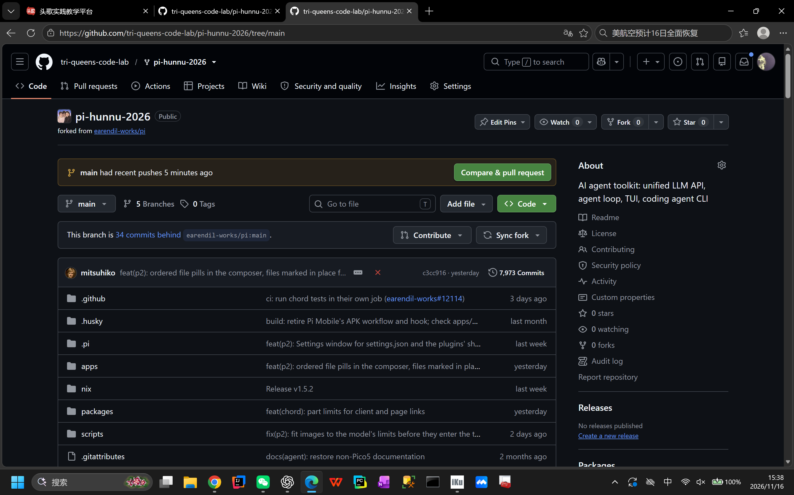
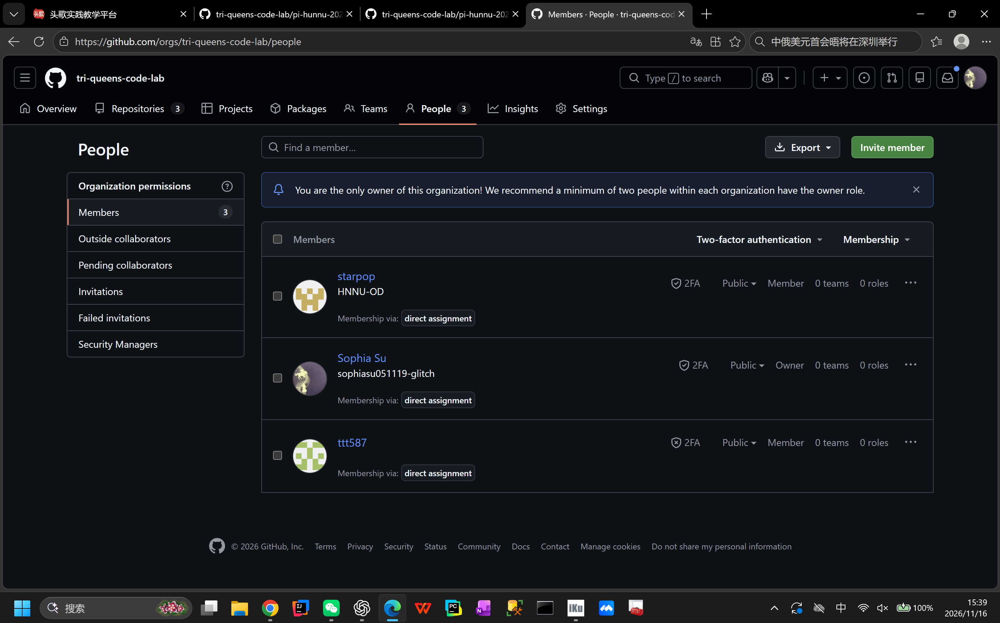
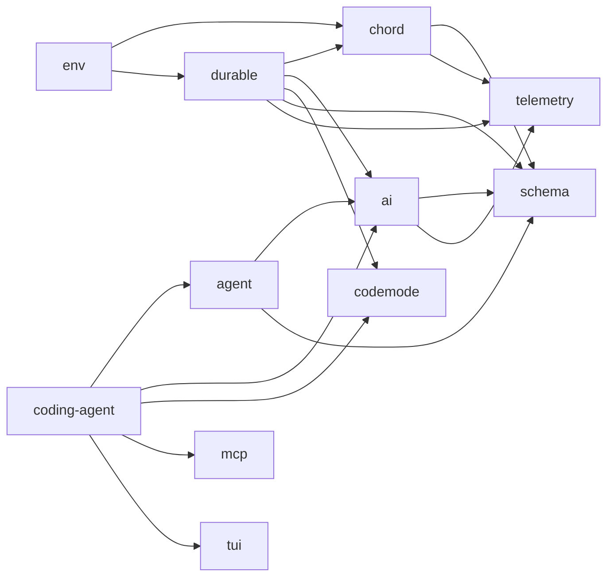

# 实践课 2：组织建仓与源码分析

- 姓名：苏可
- 身份：小组组长
- 小组组织：`tri-queens-code-lab`
- 小组仓库：<https://github.com/tri-queens-code-lab/pi-hunnu-2026>
- 分支：`main`
- 分析提交：`c3cc91632d0a1950fb122605b190233f2aa0006e`
- 分析日期：2026-11-16

## 1. 小组仓库与成员

小组仓库已建立在 GitHub 组织 `tri-queens-code-lab` 下，仓库为公开仓库。组长苏可为组织 Owner，另外两位组员已加入组织并具有 Member 身份。实践使用 `main` 分支，该分支已与教师课程仓库 `hunnuOpenSourceSoftware2026/pi-hunnu-2026` 的指定提交保持一致。





## 2. 本地仓库信息

```text
本地路径：C:\Users\Sophi\Documents\Codex\2026-11-10\referenced-chatgpt-conversation-this-is-an\work\group-pi-hunnu-2026
当前分支：main
HEAD：c3cc91632d0a1950fb122605b190233f2aa0006e
origin：https://github.com/tri-queens-code-lab/pi-hunnu-2026.git
upstream：https://github.com/hunnuOpenSourceSoftware2026/pi-hunnu-2026.git
工作区状态：clean
```

## 3. 根目录构建配置

根目录 `package.json` 将项目声明为 npm workspaces 单体仓库，Node.js 版本要求为 `>=22.19.0`。根目录的 `build` 脚本依次进入以下 11 个模块执行各自的构建：

```text
telemetry → schema → chord → tui → codemode → mcp → ai → durable → env → agent → coding-agent
```

普通 TypeScript 模块主要执行 `tsc -p tsconfig.build.json` 并将 JavaScript 与类型声明生成到 `dist/`。`ai` 先在线生成模型目录数据，再执行离线编译和数据复制；`coding-agent` 先生成未打包文件、复制主题及 HTML 等资源，最后生成 `dist/bundle`。

## 4. 模块分析表

表中“直接内部依赖”只统计各模块 `package.json` 中声明的 `@earendil-works/*` 依赖，不把构建顺序相邻关系当作依赖。

| 模块 | 主要功能 | 构建动作与产物 | 直接内部依赖 | 证据 |
|---|---|---|---|---|
| `telemetry` | 为 Pi 提供与厂商无关的遥测契约、类型化模式及适配基础 | `tsc -p tsconfig.build.json`，输出到 `dist/` | 无 | `packages/telemetry/package.json` 的 `description`、`scripts.build`、`dependencies` |
| `schema` | 不使用 `eval` 的 JSON Schema 校验，支持 2020-12 与 draft-7 | `tsc -p tsconfig.build.json`，输出到 `dist/` | 无 | `packages/schema/package.json` |
| `chord` | 跨进程对象运行时，提供契约、文档、存储、链接、插件、HTTP、Worker 和客户端能力 | `tsc -p tsconfig.build.json`，输出到 `dist/` | `schema`、`telemetry` | `packages/chord/package.json` |
| `tui` | 终端用户界面库，使用差分渲染提高文本界面效率 | `tsc -p tsconfig.build.json`，输出到 `dist/`；另有各平台原生构建脚本 | 无 | `packages/tui/package.json` |
| `codemode` | 在受限环境中执行 JavaScript，只允许调用注入的工具 | `tsc -p tsconfig.build.json`，输出到 `dist/` | 无 | `packages/codemode/package.json` |
| `mcp` | 独立的 Model Context Protocol 客户端，供 Pi 或其他程序连接 MCP 服务 | `tsc -p tsconfig.build.json`，输出到 `dist/` | 无 | `packages/mcp/package.json` |
| `ai` | 统一多供应商 LLM API，负责模型发现和供应商配置 | 先 `generate-models`，再校验数据、运行 TypeScript 编译并复制供应商数据到 `dist/providers` | `schema`、`telemetry` | `packages/ai/package.json` 的 `scripts.build`、`scripts.build:offline` |
| `durable` | 持久化对话、任务与文档运行时 | `tsc -p tsconfig.build.json`，输出到 `dist/` | `chord`、`ai`、`codemode`、`schema`、`telemetry` | `packages/durable/package.json` |
| `env` | 通过 SSH 部署小型守护进程，为 Pi Durable 提供远程执行环境 | TypeScript 构建输出到 `dist/`；守护进程另有 Cargo 构建脚本 | `chord`、`durable` | `packages/env/package.json` |
| `agent` | 通用 Agent 核心，包含传输抽象、状态管理、工具调用与附件支持 | `tsc -p tsconfig.build.json`，输出到 `dist/` | `ai`、`schema` | `packages/agent/package.json` |
| `coding-agent` | 带读取、命令、编辑、写入工具及会话管理的编码 Agent 命令行程序 | TypeScript 编译、设置可执行入口、复制资源并生成 `dist/bundle/cli.js` | `agent`、`ai`、`codemode`、`mcp`、`tui` | `packages/coding-agent/package.json` 的 `bin`、`scripts.build`、`dependencies` |

## 5. 模块依赖图

箭头方向为“使用者 → 被依赖模块”。可编辑源文件为 [`module-dependencies.mmd`](module-dependencies.mmd)。



## 6. 思考题

### 6.1 根目录和子模块如何配置构建？实际执行了什么？

根目录通过 npm workspaces 管理多个包，但 `build` 没有简单地并行调用所有 workspace，而是用连续的 `cd ... && npm run build` 明确控制顺序。大部分子模块的 `build` 都调用 TypeScript 编译器读取 `tsconfig.build.json`，生成 JavaScript 和 `.d.ts` 类型声明到 `dist/`。`ai` 还要从外部模型目录生成供应商数据，`coding-agent` 还会复制主题、图片和导出 HTML 资源，并把 CLI 依赖打包到 `dist/bundle`。

### 6.2 构建顺序与依赖关系有什么关系？相邻构建是否必然存在依赖？

构建顺序总体遵守“被依赖模块先构建、使用者后构建”，例如 `schema`、`telemetry` 在 `chord` 与 `ai` 之前，`ai` 在 `agent` 之前，`agent` 在 `coding-agent` 之前。但相邻构建不必然存在依赖，例如 `schema` 后面构建 `chord`，`chord` 确实依赖 `schema`；而 `chord` 后面构建 `tui`，`tui` 并不依赖 `chord`。因此依赖关系必须以各模块 `package.json` 的依赖声明为证据，不能只凭脚本先后顺序判断。

### 6.3 给出一条至少跨越 3 个模块的依赖路径

一条满足条件的路径是：

```text
coding-agent → agent → ai → schema
```

`coding-agent` 直接依赖 `agent`，`agent` 直接依赖 `ai`，`ai` 又直接依赖 `schema`，共跨越 3 条依赖边、涉及 4 个模块。另一条路径是 `env → durable → ai → telemetry`。

## 7. 实践结论

本项目是以 npm workspaces 组织的 TypeScript 单体仓库。根构建脚本按稳定顺序串行构建模块，但真实模块关系应从各包的依赖声明读取。底层的 `schema`、`telemetry` 等模块被多个上层模块复用，最终由 `coding-agent` 汇总核心 Agent、AI、TUI、MCP 和代码执行能力，形成可运行的 CLI。

