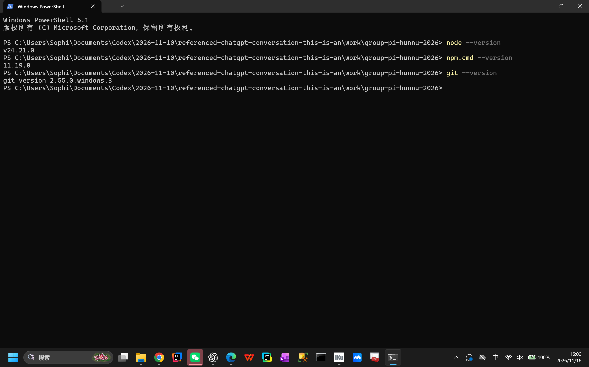
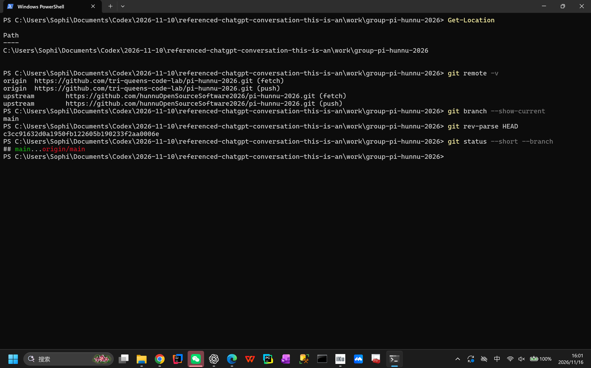
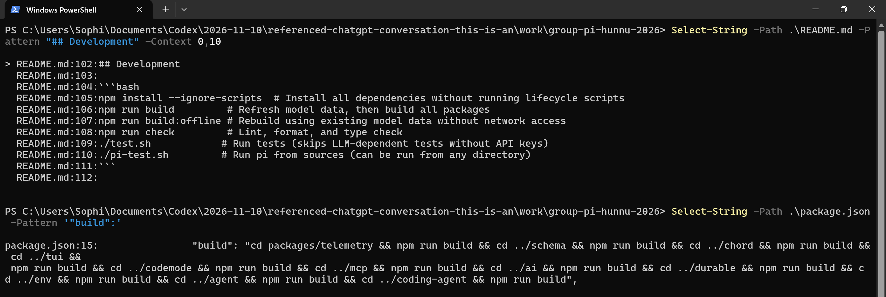
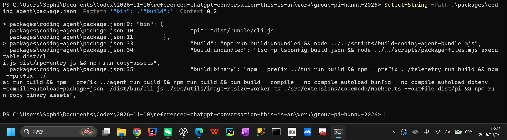
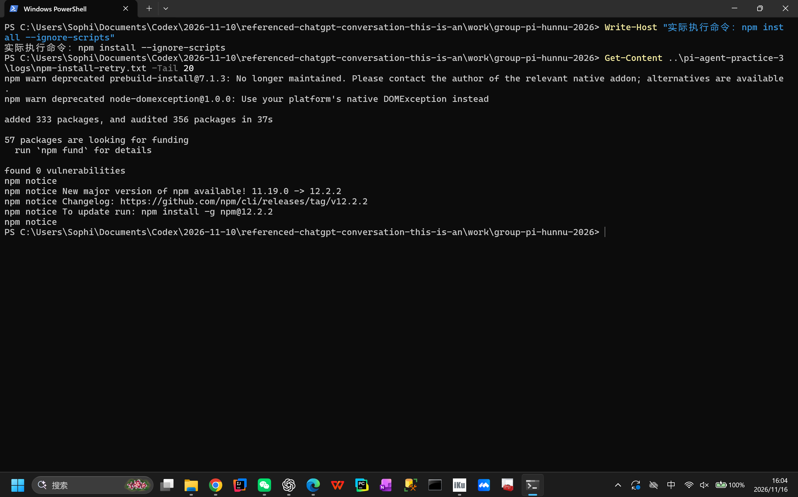
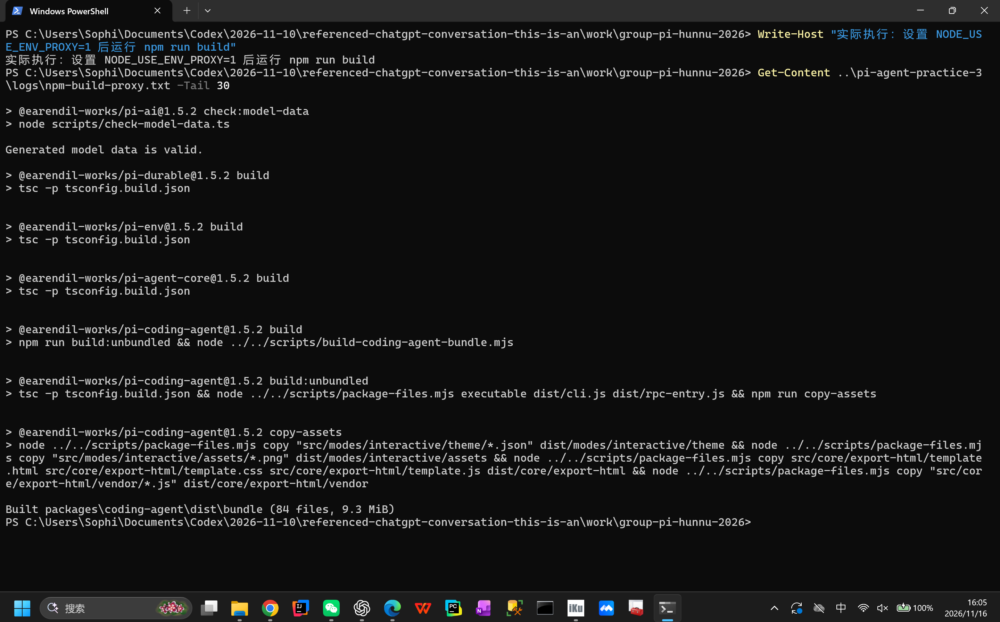
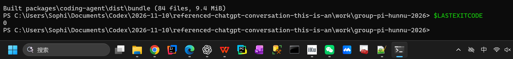
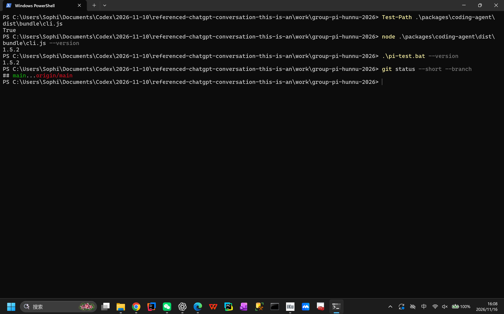
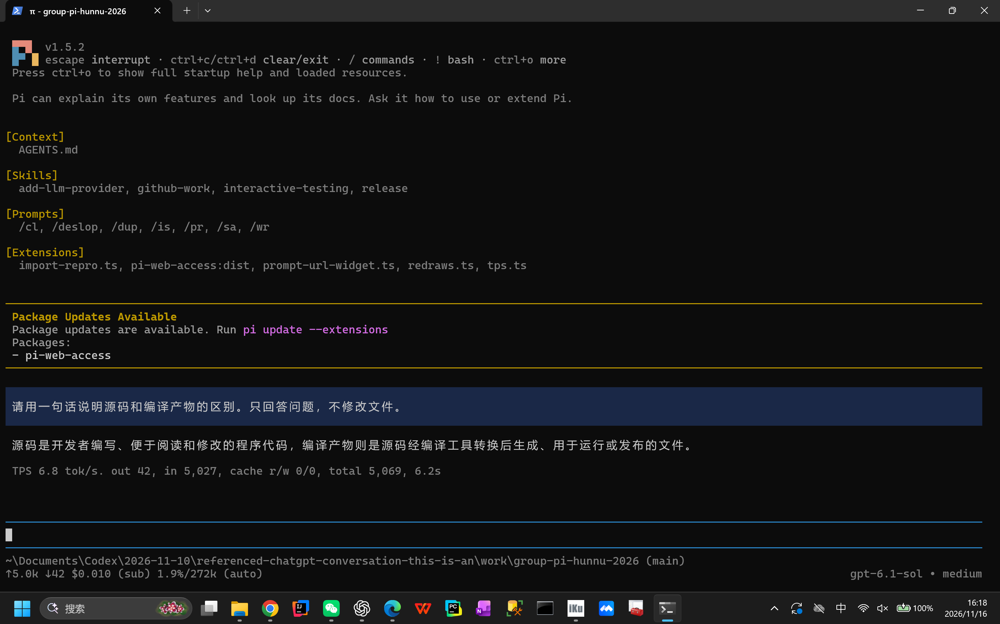

# 实践课 3：Pi Agent 源码安装与编译

- 姓名：苏可
- 小组组织：`tri-queens-code-lab`
- 小组仓库：<https://github.com/tri-queens-code-lab/pi-hunnu-2026>
- 分支：`main`
- 源码提交：`c3cc91632d0a1950fb122605b190233f2aa0006e`
- 实践日期：2026-11-16

## 1. 实践环境（S1）

| 工具 | 版本 |
|---|---|
| Windows | Windows 11 |
| Node.js | `v24.21.0` |
| npm | `11.19.0` |
| Git | `2.55.0.windows.3` |



根目录 `package.json` 要求 Node.js `>=22.19.0`，本机版本满足要求。

## 2. 获取并核对小组源码（S2）

本地仓库信息：

```text
路径：C:\Users\Sophi\Documents\Codex\2026-11-10\referenced-chatgpt-conversation-this-is-an\work\group-pi-hunnu-2026
分支：main
HEAD：c3cc91632d0a1950fb122605b190233f2aa0006e
origin：https://github.com/tri-queens-code-lab/pi-hunnu-2026.git
upstream：https://github.com/hunnuOpenSourceSoftware2026/pi-hunnu-2026.git
```



## 3. 阅读构建与入口配置（S3）

根目录 `README.md` 的 Development 部分给出的主要流程是：

```powershell
npm install --ignore-scripts
npm run build
./pi-test.sh
```

Windows 使用课程仓库提供的 `pi-test.bat`。根目录 `package.json` 的 `build` 按以下顺序构建 11 个包：

```text
telemetry → schema → chord → tui → codemode → mcp → ai → durable → env → agent → coding-agent
```

`packages/coding-agent/package.json` 中的关键配置：

```json
{
  "bin": { "pi": "dist/bundle/cli.js" },
  "scripts": {
    "build": "npm run build:unbundled && node ../../scripts/build-coding-agent-bundle.mjs"
  }
}
```

这说明源码入口经 TypeScript 编译、资源复制和打包后，最终命令行入口为 `packages/coding-agent/dist/bundle/cli.js`。





## 4. 安装依赖（S4）

执行：

```powershell
npm install --ignore-scripts
```

最终结果：

```text
added 333 packages, and audited 356 packages in 37s
found 0 vulnerabilities
```



使用 `--ignore-scripts` 的作用是安装依赖时不运行第三方包的生命周期脚本，从而减少安装阶段执行额外代码的风险，也与项目 README 和老师要求一致。

## 5. 编译源码与核验产物（S5）

执行完整在线构建：

```powershell
$env:NODE_USE_ENV_PROXY='1'
npm run build
```

11 个模块均完成构建，最终输出：

```text
Built packages\coding-agent\dist\bundle (84 files, 9.3 MiB)
```

构建结束后 PowerShell 正常返回命令提示符，没有出现 `npm ERR!` 或 TypeScript 报错。随后对产物存在性和两个本地入口的版本进行了交叉核验。

随后核验：

```powershell
Test-Path .\packages\coding-agent\dist\bundle\cli.js
node .\packages\coding-agent\dist\bundle\cli.js --version
.\pi-test.bat --version
```

结果：

```text
True
1.5.2
1.5.2
```



为补充保留老师要求的明确退出码证据，我之后在同一源码项目完成下一次完整构建后，紧接着检查 `$LASTEXITCODE`，结果为 `0`；截图同时保留了构建末尾的 `Built packages\coding-agent\dist\bundle` 成功信息。





## 6. 从本地源码启动交互界面（S6）

执行：

```powershell
.\pi-test.bat
```

在首次信任提示中选择了仅本次会话信任，然后输入：

```text
请用一句话说明源码和编译产物的区别。只回答问题，不修改文件。
```

Pi 返回：

```text
源码是开发者编写、便于阅读和修改的程序代码，编译产物则是源码经编译工具转换后生成、用于运行或发布的文件。
```



这次运行使用的是仓库根目录的 `pi-test.bat`。该脚本调用 `pi-test.ps1`，由 Node.js 加载仓库内的本地入口，而不是从 npm 全局安装的 `pi` 命令；`--version` 与编译产物均显示 1.5.2，证明本地源码及其构建产物可以正常启动。

## 7. 遇到的问题与解决方法

### 7.1 Windows 创建 workspace 符号链接失败

第一次执行 `npm install --ignore-scripts` 时出现 `EPERM: operation not permitted, symlink`。原因是 npm workspace 需要为示例扩展创建符号链接，而当前 Windows 进程权限不允许。使用允许创建符号链接的权限重新执行同一条安装命令后成功。安装结束后 `git status --short` 为空，说明没有改动受 Git 跟踪的源码。

### 7.2 在线模型目录连接超时

第一次运行 `npm run build` 时，前六个 TypeScript 模块已经成功，但 `pi-ai` 在 `Fetching models.dev catalog...` 处超时。直接访问该网址正常，说明不是源码错误，而是 Node.js 没有自动使用当前系统代理。设置 `NODE_USE_ENV_PROXY=1` 后重新执行原命令，模型目录成功获取，全部 11 个模块完整构建通过。

### 7.3 首次启动无法创建会话目录

首次启动本地交互界面时，受限进程不能在用户目录 `.pi/agent/sessions` 创建会话。允许本地 Pi 写入自己的用户配置与会话目录后，程序正常启动。项目信任选择的是“仅本次会话”，没有永久扩大项目权限。

## 8. 实践结论

本次实践完成了开发环境核对、课程小组仓库源码确认、依赖安装、11 个工作区模块的完整编译、CLI 产物验证以及本地源码交互运行。最终生成的 `dist/bundle/cli.js` 存在且版本为 1.5.2，`pi-test.bat` 能从本地仓库启动并返回有效回答；构建后 Git 工作区保持干净。

