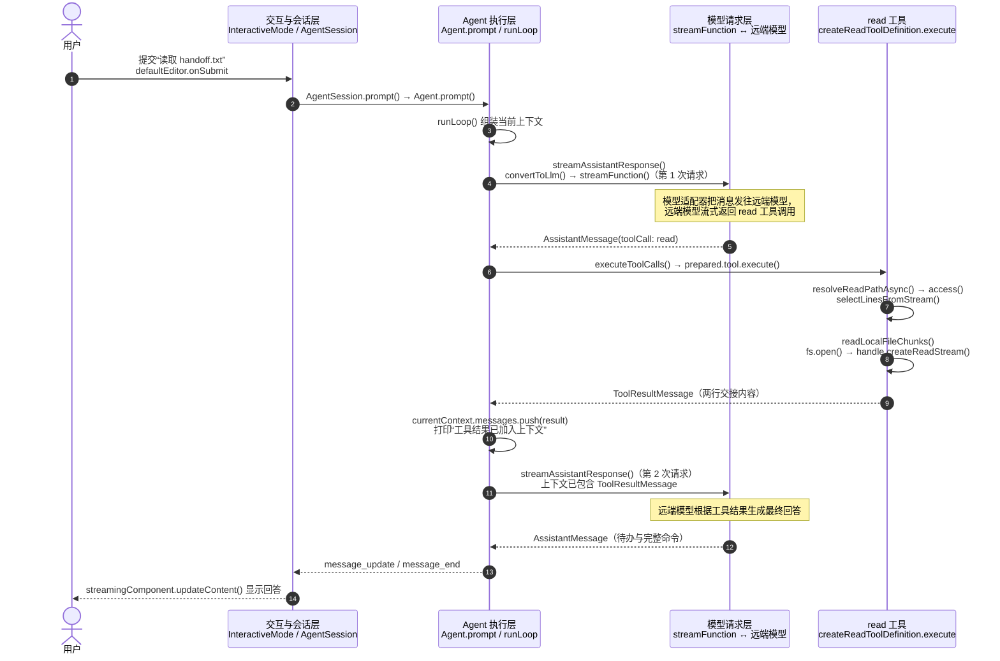
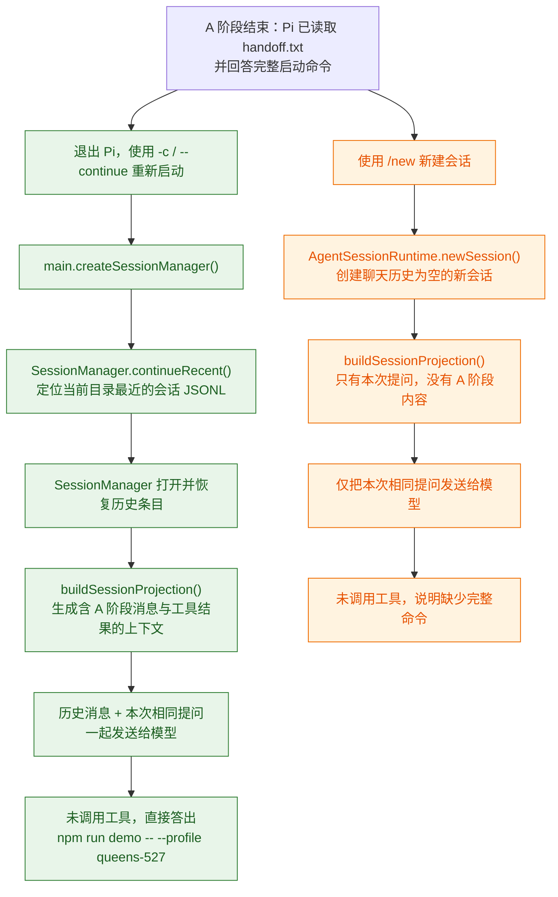

# 实践课 5：Pi Agent 源码泛读与功能定位

- 姓名：苏可
- GitHub：[@sophiasu051119-glitch](https://github.com/sophiasu051119-glitch)
- 小组组织：[`tri-queens-code-lab`](https://github.com/tri-queens-code-lab)
- 小组源码仓库：[`pi-hunnu-2026`](https://github.com/tri-queens-code-lab/pi-hunnu-2026)
- 实验日期：2026-11-26
- 本地 Pi 版本：1.5.2
- 实验模型：`openai/gpt-6.1-sol`
- 课程要求：[`05-Pi-Agent-source-reading.md`](https://github.com/hunnuOpenSourceSoftware2026/assignments/blob/main/practice/05-Pi-Agent-source-reading.md)

## 1. 实验准备

本实验复用实践 04 已加入 `packages/agent/src/agent-loop.ts` 的两条日志：

```text
[P4] Agent 即将请求模型
[P4] 工具结果已加入上下文
```

在 Pi 项目根目录创建 [`handoff.txt`](practice-5/handoff.txt)，内容如下：

```text
待办：补充 README 的启动说明
启动命令：npm run demo -- --profile queens-527
```

`queens-527` 是本组为实验生成的标识。向 Pi 提问时没有在问题中泄露该命令。

## 2. A 阶段：单轮交互与工具调用

输入：

> 请用 read 工具读取当前目录的 handoff.txt，原样告诉我待办和启动命令。

实际运行顺序为：

```text
[P4] Agent 即将请求模型
[P4] 工具结果已加入上下文
[P4] Agent 即将请求模型
待办：补充 README 的启动说明
启动命令：npm run demo -- --profile queens-527
```

完整记录见 [`01-read-tool.txt`](practice-5/evidence/01-read-tool.txt)。一次用户输入触发了两次模型请求和一次 `read` 工具调用：第一次模型请求产生工具调用，工具结果加入上下文后，第二次模型请求生成面向用户的最终回答。

### 图 1：单轮工具调用的代码级时序图



### 代码定位与边界核对

| 职责 | 源码位置 | 关键函数或语句 | 本次观察 |
|---|---|---|---|
| 用户输入入口 | `packages/coding-agent/src/modes/interactive/interactive-mode.ts` | `defaultEditor.onSubmit`、`session.prompt()` | 把一次编辑器提交交给会话层 |
| 会话到 Agent | `packages/coding-agent/src/core/agent-session.ts` | `_startRun()`、`agent.prompt(messages)` | 启动本轮 Agent 运行 |
| Agent 循环 | `packages/agent/src/agent.ts`、`agent-loop.ts` | `Agent.prompt()`、`runLoop()` | 负责“模型调用—工具执行—继续模型调用”的内循环 |
| 模型边界 | `packages/agent/src/agent-loop.ts` | `streamAssistantResponse()`、`streamFunction(config.model, llmContext, ...)` | 适配器向远端模型发请求并接收流式响应 |
| 工具调度 | `packages/agent/src/agent-loop.ts` | `executeToolCalls()`、`executePreparedToolCall()` | 调用 `prepared.tool.execute()` 并形成工具结果消息 |
| 文件系统边界 | `packages/coding-agent/src/core/tools/read.ts` | `readLocalFileChunks()`、`fsOpen()`、`handle.createReadStream()` | 本次文本文件走流式读取，不是整文件缓冲读取 |
| 回答显示 | `packages/coding-agent/src/modes/interactive/interactive-mode.ts` | `message_update`、`message_end`、`updateContent()` | 流式更新并最终固定用户看到的回答 |

`read` 工具的默认操作同时提供 `readFile` 与 `createReadStream`。本次没有指定特殊范围，满足 `isStreamableRange`，因此源码选择 `selectLinesFromStream(ops.createReadStream(...))`；默认实现继续进入 `readLocalFileChunks()`，使用 `fs.open()` 和 `FileHandle.createReadStream()` 读取文本。

## 3. B 阶段：恢复旧会话与新建会话

两次实验使用相同模型和完全相同的问题：

> 接着上次的待办，给 README 起草一条启动说明，写出交接单里的完整启动命令。只用这次会话已有的信息。不要调用工具。如果缺少命令，请直接说明。

### 实际结果对照

| 对照项 | 恢复旧会话（`-c` / `--continue`） | 新建会话（`/new` 等价的新会话） |
|---|---|---|
| 历史消息 | 含 A 阶段用户消息、`read` 调用、工具结果和回答 | 空，不含 A 阶段内容 |
| 模型请求次数 | 1 次 | 1 次 |
| 是否调用工具 | 否 | 否 |
| 是否得到完整命令 | 是，准确给出 `npm run demo -- --profile queens-527` | 否，明确说明缺少交接信息 |
| 证据 | [`02-continue-session.txt`](practice-5/evidence/02-continue-session.txt) | [`03-new-session.txt`](practice-5/evidence/03-new-session.txt) |

恢复旧会话的回答：

> 启动演示：在项目根目录运行 `npm run demo -- --profile queens-527`。

新会话的回答：

> 当前会话没有上次的待办、交接单内容或完整启动命令，无法据此起草准确的 README 启动说明。请提供交接单中的完整启动命令；我不会猜测或补造命令。

### 图 2：恢复旧会话和新建会话的对照图



## 4. 结论

1. “一轮交互”不等于“一次模型请求”。当模型先产生工具调用时，Pi 会执行工具，把 `ToolResultMessage` 加入上下文，再请求模型生成最终回答。本次一轮交互实际包含 2 次模型请求和 1 次工具调用。
2. `read` 工具是模型与本地文件系统之间的边界。此次普通文本读取实际走 `fs.open()` 与 `FileHandle.createReadStream()` 的流式路径。
3. `-c` 恢复的不只是界面上的聊天文本。`SessionManager` 从持久化会话中恢复历史条目，`buildSessionProjection()` 将它们重建为后续请求的模型上下文，因此模型无需再次读取文件就能使用旧命令。
4. `/new` 创建空历史会话。相同模型、相同问题、相同工具配置下，新会话无法知道旧交接单命令，说明差异来自会话上下文，而不是模型参数或工具配置。
