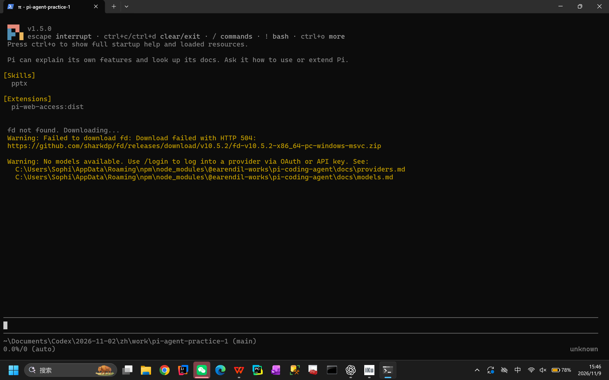
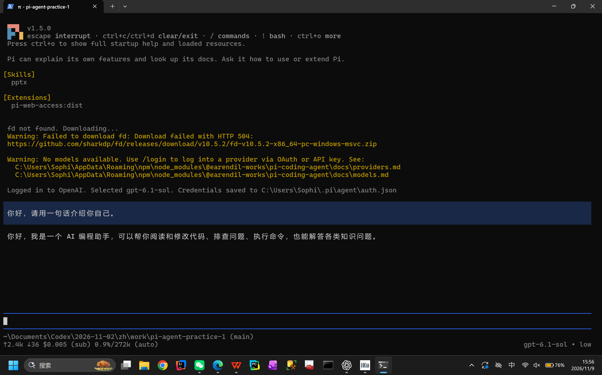
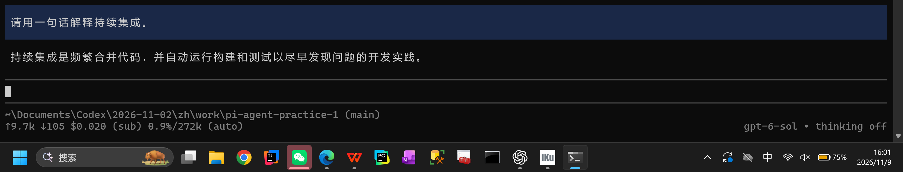
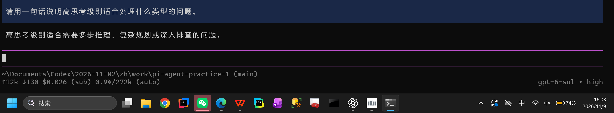
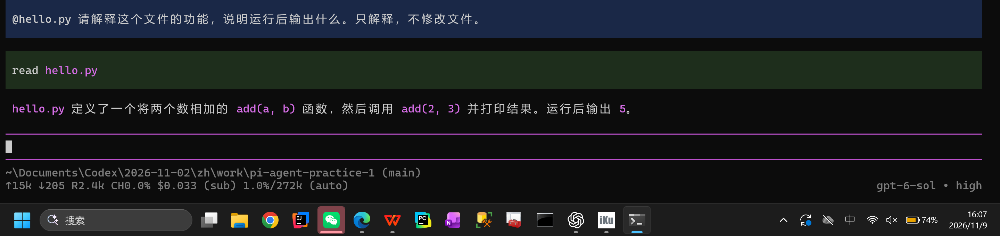
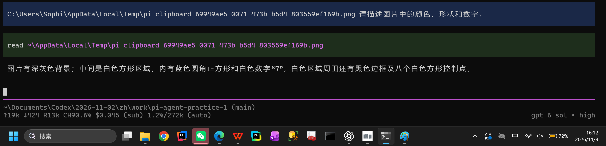
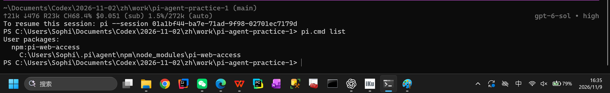
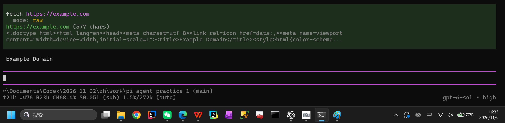
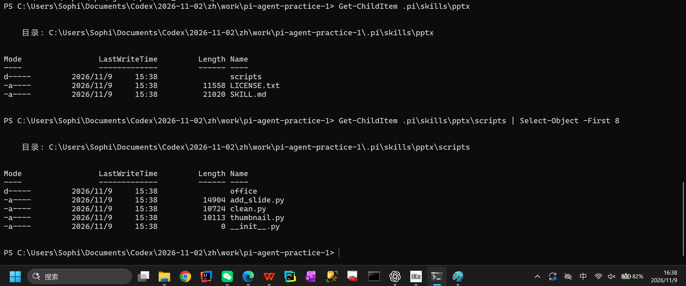
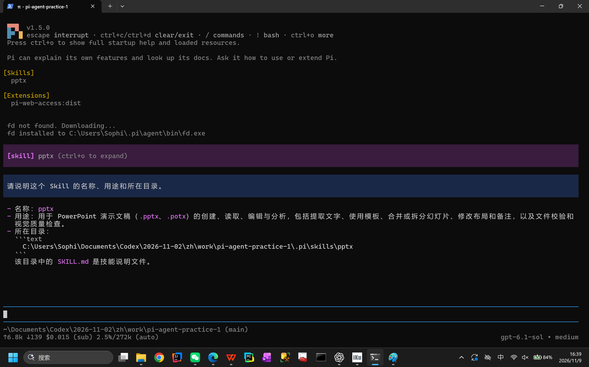

# Pi Agent 安装与基础使用实践报告

## 1. 实践信息

- 姓名：苏可
- GitHub：`sophiasu051119-glitch`
- 日期：2026 年 11 月
- Pi 版本：`1.5.0`
- 操作系统：Windows 11
- Node.js：`v24.21.0`
- npm：`11.19.0`
- Git：`2.55.0.windows.3`

## 2. 实践内容

### 2.1 安装并启动 Pi

本机原来已经安装 Node.js、npm 和 Git，但没有 Pi。我使用官方 npm 包安装：

```powershell
npm install -g --ignore-scripts @earendil-works/pi-coding-agent
```

安装后运行 `pi --version`，得到 `1.5.0`。随后在本仓库目录启动 Pi，确认程序能够正常进入交互界面。



### 2.2 配置模型并完成会话

我在 `/login` 中选择账户登录，并通过 OpenAI 账户完成授权。登录后 Pi 自动选择 `gpt-6.1-sol`，初始思考级别为 `low`。我发送“你好，请用一句话介绍你自己”，模型能够正常回复。报告和仓库中没有保存 `auth.json`、授权链接或任何凭据。



### 2.3 切换模型和思考级别

我先用 `/model` 将模型从 `gpt-6.1-sol` 切换为 `gpt-6-sol`，并用“请用一句话解释持续集成”确认新模型可以正常会话。切换完成后，状态栏显示 `gpt-6-sol`，当时思考级别为 `off`。



随后使用 `/thinking` 将思考级别调整为 `high`。低或关闭思考适合简单问答，响应更快；较高思考级别更适合多步推理、复杂规划和深入排查，但通常需要更长时间。



### 2.4 引用代码文件

我创建了 `hello.py`，其中 `add(a, b)` 返回两个参数的和，最后执行 `print(add(2, 3))`。在 Pi 中通过 `@hello.py` 引用文件，并询问程序功能。回复正确识别了 `add` 函数，运行结果为 `5`。



### 2.5 粘贴图片并测试识别

测试图片是 200×200 像素的 PNG：白色背景中有蓝色方块，中央是白色数字 7。


我使用 `Alt+V` 粘贴剪贴板图像。Pi 将图片保存为 `pi-clipboard-...png` 临时文件，说明输入来自剪贴板而不是手动输入原文件路径。模型识别出了蓝色圆角方块和数字 7。



### 2.6 安装并使用插件

我从 Pi Package Catalog 选择了 `pi-web-access`。该插件提供网页搜索、网页内容获取等能力，安装命令为：

```powershell
pi install npm:pi-web-access
```

安装后，`pi list` 显示用户级包 `npm:pi-web-access`，路径为 `C:\Users\Sophi\.pi\agent\npm\node_modules\pi-web-access`。我重新启动 Pi，确认启动信息出现该扩展，并调用一个最小网页读取任务。



我让插件获取 `https://example.com` 的网页标题。画面中出现了 `fetch` 工具调用，最后得到 `Example Domain`，说明插件不仅已经安装，而且能够实际完成网页读取。



### 2.7 安装并调用 PPT Skill

按照选做任务，我从 `anthropics/skills` 仓库下载 `skills/pptx` 完整目录，并安装到当前项目的 `.pi/skills/pptx`。目录共 56 个文件，保留了 `SKILL.md`、`LICENSE.txt` 和 `scripts` 等支持文件。下载时记录的源 commit 为 `2c5958ecac7cee2b583967a2c4981d0f4a75c579`。



重新启动 Pi 后，我检查技能发现结果，并使用 `/skill:pptx` 询问技能名称、用途和所在目录。



## 3. 问题与处理

安装 Pi 时网络连接发生过一次重置，npm 没有完成全部依赖下载。我保留已经下载的缓存后重试，第二次安装成功。安装插件时也遇到类似的网络中断，重试后 `pi list` 能正确显示包名和路径。

第一次从 PowerShell 启动时，系统执行策略阻止了 `pi.ps1`。我没有修改整个系统的安全策略，而是改用 npm 同时生成的 `pi.cmd`，之后可以正常启动。插件启动时下载 `fd` 曾返回 HTTP 504，下一次启动时自动重试并成功安装到 `C:\Users\Sophi\.pi\agent\bin\fd.exe`。

模型切换时我先尝试了 `gpt-4.1`，但 ChatGPT 账户授权不支持该模型。之后改选同一账户可用的 `gpt-6-sol`，并重新发送测试问题，最终正常得到回复。这个过程说明模型目录中的名称不一定都能被当前登录方式调用，仍要以实际请求结果为准。

这个过程让我更清楚地看到，“命令运行过”不等于“功能已经可用”。安装后还要检查版本、重启程序、查看资源加载信息，并真正调用一次功能，才能判断一项配置是否完成。

## 4. 完成情况

- [x] 安装并启动 Pi。
- [x] 配置模型并完成一次会话。
- [x] 切换模型和思考级别。
- [x] 使用 `@` 引用代码文件。
- [x] 粘贴图片并完成识别测试。
- [x] 安装 `pi-web-access` 插件。
- [x] 重启 Pi 并完成插件试用。
- [x] 安装 PPT Skill 到项目目录。
- [x] 重启 Pi 并调用 PPT Skill。
- [x] 整理全部真实截图。
- [x] 提交教师仓库 Issue：[实践课1： Pi Agent安装与使用 suke（#85）](https://github.com/hunnuOpenSourceSoftware2026/assignments/issues/85)。

